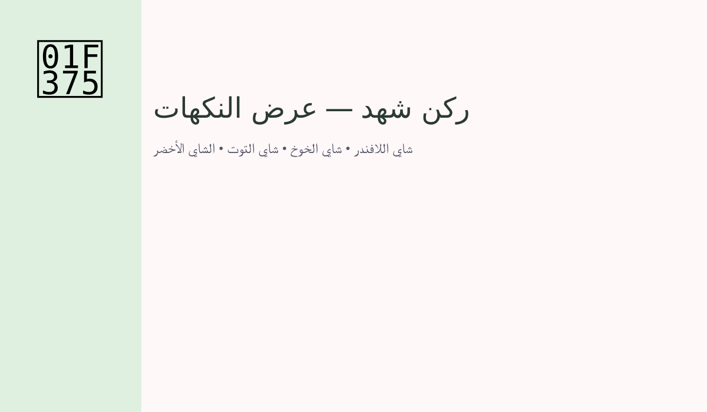
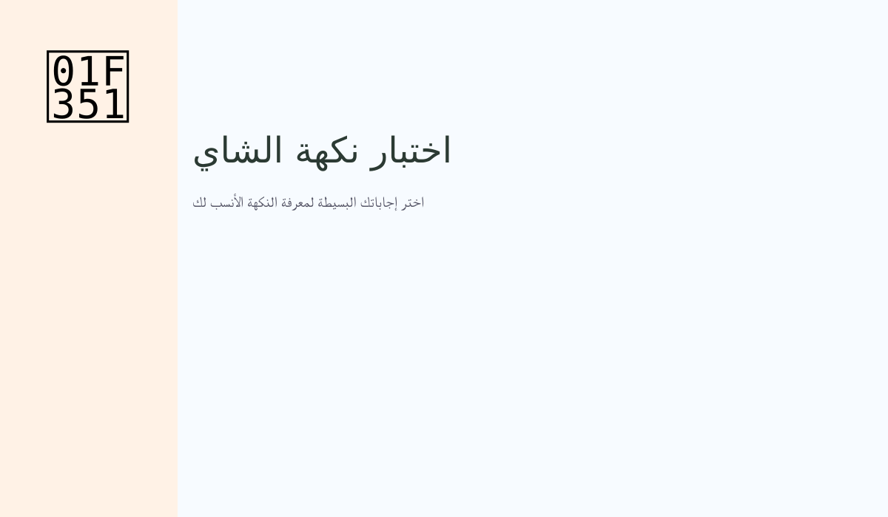

# 🍵 ركن شهد لنكهات الشاي

> تجربة ويب تفاعلية خفيفة تعرض أذواق الشاي وفوائدها مع اختبار سريع لاكتشاف النكهة المناسبة لمزاجك.

نبذة
- صفحة صغيرة تفاعلية تعرض بطاقات نكهات، معلومات مختصرة عن كل نكهة، واختبار موجز يساعد المستخدم على اكتشاف النكهة الأقرب لأسلوبه.

الملفّات الأساسية
- `index.html` — معرض النكهات مع مودال لعرض الوصف والفوائد.  
- `tea.js`, `tea.css` — سلوك الواجهة وأنماط التصميم.  
- `quiz.html`, `quiz.js`, `quiz.css` — اختبار سريع لاقتراح نكهة.

معاينة





التقنيات
- HTML5, CSS3, JavaScript (ES6)
- مكتبات: GSAP للحركات، Lucide للأيقونات

المبادئ المتبعة
- فصل منطق العرض (JS) عن التصميم (CSS).
- دعم الوصول (accessibility): المودال يدعم إغلاقًا بـ Escape والنقر خارج المحتوى، وزر إغلاق مع وسم ARIA.

كيفية التشغيل محليًا
1. افتح طرفية داخل مجلد المشروع.
2. شغّل سيرفر محلي بسيط:

```bash
python -m http.server 8000
```

3. افتح المتصفح واذهب إلى: `http://localhost:8000` ثم افتح `index.html` أو `quiz.html`.

ميزات إضافية في المشروع
- مشاركة النتيجة: زر في صفحة الاختبار يسمح بإنشاء بطاقة صورة للنتيجة لعرضها أو تنزيلها.  
- سجل النتائج: يتم حفظ آخر النتائج محليًا في `localStorage` لعرض تاريخ الاختبارات.

اقتراحات لتحسين لاحقًا (أستطيع تنفيذها)
- تحسين تصميم بطاقة المشاركة (خيارات ألوان، خلفيات، إضافة صور).  
- إمكانية مشاركة مباشرة عبر روابط تواصل اجتماعي.  
- إضافة لقطات شاشة فعلية أو تحسينات للـ SEO.

الرخصة
- هذا المشروع مرخّص بموجب رخصة MIT — راجع ملف LICENSE.

اتصال
- Email: shahadalmalkics@gmail.com
- LinkedIn: https://www.linkedin.com/in/shahad-almalkics
